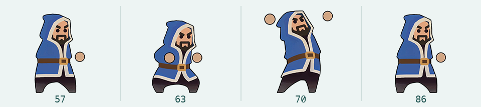

# KingdomTD Flipbook 功能说明书

一张网格图集可以同时驱动场景里的角色和 Canvas 里的界面动画。美术在同一份动画资产中划分动作、配置朝向与帧事件。场景组件和 UI 组件各自控制播放进度、速度与暂停状态。



*示例角色的 Skill01 动作。数字为图集帧号，从施法起手到收势依次取样。*

### 先在示例里看一次

1. 在 Unity 的 **Window > Package Manager** 中点 **+**，选择从 Git URL 添加包。复制仓库 HTTPS 地址，在末尾加 `#` 和目标版本的标签。[项目仓库](https://github.com/liangyh/FlipBookAnimation)
2. 选中 **KingdomTD Flipbook > Samples > Flipbook Basic**，点击 **Import**。打开导入目录的 `Scenes/FlipbookBasic.unity`，进入 Play 模式。
3. 在 Hierarchy 选中 **World Flipbook**，将 Inspector 的 **Animation** 改为 `Run`。场景角色开始跑动，Canvas 下的 **Flipbook Graphic** 仍播放 `Idle`。选中 UI 对象也可以单独切换它的动作。

## 制作动画资产

在 Project 面板选中项目 `Assets` 下的网格纹理，执行 **Create > KingdomTD > Flipbook Animation Asset + Material**。Unity 会在纹理旁创建配对的 `.asset` 和 `.mat`，绑定主纹理，并生成一个覆盖整张网格的 `Idle` 动作。已有完整、等大的矩形 Sprite 切片时会推算网格，其余纹理从 1 列 × 1 行开始配置。

### 填写网格与动作

1. 在资产 Inspector 的 **纹理与网格** 区域，填写列数和行数。每格是一帧，从左上角的 0 开始，先向右，再换到下一行。
2. 在 **动画** 区域编辑初始 `Idle`，再用 **添加动画** 创建其他动作。每个动作名称须唯一。起始帧是它在图集中的第一格，最后一格等于起始帧加帧数减一。
3. 指定 **默认动画**。在底部预览中切换动作、播放或暂停。检查顶部校验提示，重点核对帧范围、重复名称、帧率、速度倍率和事件帧。

### 对照示例图集

`Huofa.png` 是 2000 × 2000 像素，网格为 10 列 × 10 行，因此每帧为 200 × 200 像素。例如第 28 帧在第三行、第九列。配套资产 `Huofa_Flipbook.asset` 把其中 87 格分配给三个动作。

| 动作 | 起始帧 | 帧数 | 图集帧范围（含首尾） |
| --- | --- | --- | --- |
| `Idle` 待机 | 0 | 28 | 0 至 27 |
| `Run` 跑动 | 28 | 29 | 28 至 56 |
| `Skill01` 施法 | 57 | 30 | 57 至 86 |

三个动作均为 30 fps、速度倍率 1。以播放速度 1 单次播放 `Skill01`，30 帧历时 1 秒。

### 单独创建资产

用 **Create > KingdomTD > Flipbook Animation** 可创建空资产。填入主纹理、网格及至少一个动作。用于场景时，另建使用 `KingdomTD/Flipbook/World` Shader 的材质并填入 **场景材质**。Inspector 会把主纹理、效果纹理和网格同步到材质。材质的 `_MainTex` 应与资产主纹理一致。

## 接入场景与 UGUI

将 Project 中的单个动画资产拖到 Hierarchy 或 Scene View，再选择要创建的组件。UI 对象可直接拖到 Canvas 节点下创建。要给已有对象添加播放能力，可用下表的组件菜单，再将资产赋给 **Animation Asset**。

| 配置项 | 场景角色或特效 | Canvas 内的界面动效 |
| --- | --- | --- |
| 拖放菜单 | **Flipbook Renderer** | **Flipbook Graphic (UI)** |
| Add Component | KingdomTD / Flipbook Renderer | UI (Canvas) / Flipbook Graphic |
| 渲染资源 | 资产中的主纹理与 World 材质。组件管理 MeshFilter、MeshRenderer 和共享 Quad。 | 资产主纹理。组件继承 MaskableGraphic，直接生成四个顶点及当前帧的 UV。 |
| 默认时间 | Scaled，随游戏时间缩放。 | Unscaled，游戏暂停时仍可播放。 |
| 循环起点 | 新组件默认随机，可取消 Randomize Loop Start Frame 以固定首帧。 | 新组件默认从动作首帧开始，也可开启随机起点。 |

### 场景朝向与染色

**Face Camera** 使角色面向主相机。默认旋转父节点，若角色的父节点同时控制移动方向，可关闭 **Rotate Parent For Billboard**，让旋转作用在显示对象自身。

场景材质的 **Effect Texture / Effect Rate** 控制效果图混合，**Change Color / Change Rate** 控制染色。角色默认读取共享材质的参数。要让单个角色闪红，在已初始化的组件上调用 `SetChangeColor(Color.red)`、`SetChangeRate(1f)`，闪烁结束后将比例改回 `0f`。`SetEffectChangeRate(rate)` 可单独覆盖效果图混合比例。

同材质的角色可以同时播放不同帧。组件用 MaterialPropertyBlock 设置实例参数，批量绘制时可在共享材质上启用 **Enable GPU Instancing**。

### UI 尺寸与遮罩

**Set Native Size** 将 RectTransform 调为单帧像素尺寸，在示例中为 200 × 200。**Preserve Aspect** 控制拉伸时是否保持比例。组件支持 Graphic 颜色、Mask、RectMask2D 和 Raycast Target。**Pause When Culled** 默认开启，Canvas 裁掉该 Graphic 时暂停推进。内置 UI 绘制使用主纹理，效果图混合属于场景材质。

## 播放控制与事件

两个组件位于 `KingdomTD.Flipbook` 命名空间。它们都支持 **Play On Enable**、**Loop**、**Speed**，也提供相同的播放方法。组件 **Animation** 可覆盖资产的默认动作。编辑态切换可看首帧，Play 模式切换用于试播。运行时换资产时，由业务代码加载后调用 `SetAsset(asset)`。

| 操作 | 行为 |
| --- | --- |
| `Play("Run", forceRestart: false)` | 同一动作仍在播放或暂停时，保留进度，更新循环与速度并继续。默认的 `forceRestart: true` 会重新开始。找不到动作时返回 `false`。 |
| `Pause()` / `Resume()` | 暂停或从当前帧继续。 |
| `Stop()` / `Stop(false)` | 停止。前者回到动作首帧，后者保留当前画面。 |
| `SetNormalizedTime(0.5f)` | 按比例定位当前动作。`0` 对应首帧，`1` 对应末帧。定位操作不补发经过的事件。 |
| `SetSpeed(2f)` / `SetTimeMode(mode)` | 调整播放倍速或时间来源。有效帧率等于动作帧率 × 动作速度倍率 × 播放倍速。时间模式可选 Scaled 或 Unscaled。 |

### 让特效在指定帧触发

要在 `Skill01` 抬手时播放粒子特效，在 **动画 > Skill01 > 帧事件** 添加事件 `Cast`，局部帧填 `13`。动作从图集第 57 帧开始，事件对应图集第 70 帧。示例原始资产的事件列表为空。

关闭粒子的 **Play On Awake**，将它赋给业务组件的 **Cast Effect** 字段。在角色的 **Frame Event** 中绑定下方方法的 **Dynamic string** 项，然后调用 `actor.Play("Skill01", loop: false)`。

```csharp
[SerializeField] private ParticleSystem _castEffect;

public void OnFlipbookEvent(string eventName)
{
    if (eventName == "Cast")
    {
        _castEffect.Play();
    }
}
```

也可在代码中订阅 `FrameEvent`。命中播放起始帧时立即触发，跨帧时按顺序补发，循环时每轮可再次触发。单次播放自然结束会停在末帧，通过 Inspector 的 **Animation Completed** 和 C# 事件 `AnimationCompleted` 传出动作名。

## 多方向与镜像

在资产 **朝向** 区选择模板，再到 **动画** 区为每个自行绘制的方向填写起始帧。同一动作的各方向共用帧数、帧率、速度倍率与帧事件，因此转身可以接着当前步伐播放。

| 模板 | 需要提供的方向帧 | 模板中的镜像关系 |
| --- | --- | --- |
| 单方向 | 一段连续帧 | 所有朝向使用同一段，适用于示例角色。 |
| 左右 | Right | Left 水平镜像 Right。 |
| 4 方向 | E、N、S | W 水平镜像 E。 |
| 8 方向 | E、NE、N、S、SE | NW 镜像 NE，W 镜像 E，SW 镜像 SE。 |

### 配置和预览

**紧密排列** 按动作帧数排布各段，**每方向一行** 按图集行对齐。镜像或原样复用时，来源须直接指向一个自行绘制的方向。方向表可自定义名称、角度和来源。缺少方向起始帧时回退到动作的 `StartFrame`。点击罗盘或切换预览方向，可检查各方向的首帧与翻转。

### 从移动方向选帧

屏幕角度从右方的 0° 逆时针增加，上方为 90°、左方为 180°、下方为 270°。组件默认初始角度为 270°，默认 5° 的方向切换回差可减少在边界来回跳向。

```csharp
// 用角色的地面 XZ 速度换算相对主相机的方向。
actor.SetFacingWorld(velocity);
actor.Play("Run", forceRestart: false);

// 让 UI 朝左，可使用屏幕向量或角度。
graphic.SetFacing(Vector2.left);
graphic.SetFacingAngle(180f);
```

近零向量会保留原朝向。播放中只切换朝向时，局部帧和事件进度都会保留。可读取 `CurrentDirectionIndex` 和 `IsFlippedX` 检查实际选择，或用 `SetDirection(index)` 按表精确指定。本页的多方向效果需要一份已配置方向表的资产。

## URP 地面阴影

场景角色可把当前帧的轮廓投到指定的水平地面。轮廓取自主纹理的 Alpha，使用 World 材质的 **Alpha Cutoff** 裁切，并跟随动作和水平镜像。

### 启用阴影

1. 在项目实际使用的每个 **URP Renderer 资产**上，执行 **Add Renderer Feature > Flipbook Ground Shadow Renderer Feature**。确认 Feature 已启用，**Layer Mask** 包含角色所在层。
2. 使用 URP **Render Graph** 路径。在启用 **Compatibility Mode (Render Graph Disabled)** 的项目中，角色本体可见，阴影 Pass 不执行。
3. 给角色资产指定包内 World Shader 材质，在角色的 **Flipbook Renderer** 勾选 **Ground Shadow Enabled**。从上方略带俯角观察投影。

### 调整地面、脚底和浓淡

场景中添加 **KingdomTD > Flipbook Ground Shadow Settings** 可统一控制投影。普通场景采用最后启用的设置。没有设置组件时采用下表默认值。

| 参数 | 默认值 | 调整依据 |
| --- | --- | --- |
| Screen Angle | 45° | 屏幕右上方。0° 和 180° 会使投影与脚底线重合，面积为零。 |
| Length / Ground Height | 0.7 / 0 | 长度按整帧角色高度计，地面高度是世界 Y 坐标。角色跳起时影子仍在该高度。 |
| Shadow Color | 深灰，Alpha 1 | Alpha 控制不透明度，0 为不可见。阴影测试场景另设为 0.5。 |
| Ground Shadow Foot Height | 0 | 此项在每个角色上设置。若 200 像素高的帧底有 14 像素留白，填 14 ÷ 200 = 0.07。 |

### 从 1.0.x 升级

原来已勾选角色阴影的工程，升级到 **1.1.0** 时还需完成上面的 Renderer Feature 和 Render Graph 配置。分别检查桌面、移动等画质等级实际使用的 Renderer。

半透明投影用模板位使重叠区域保持同一深浅。材质的 **Ground Shadow Stencil Bit** 默认为 2，与其他效果冲突时可改用空闲的 1。需要相互去重的角色应使用同一位。相机直接输出 RenderTexture 时选择带 S8 的深度模板格式，例如 `D24_UNorm_S8_UInt`。只有深度的格式会使重叠处再次加深。

## 示例验收与故障排查

### 两个场景怎样验证

| 场景 | 操作与预期 |
| --- | --- |
| `FlipbookBasic.unity` | 两个对象引用同一资产。分别播放 Run、Idle，观察各自动作。将游戏时间缩放设为 0，默认时间模式下场景角色定格，未被裁掉的 UI 继续播放。 |
| `FlipbookGroundShadowTest.unity` | 配好 Renderer Feature 后进入 Play。默认单角色播放 Skill01，点击 Pause 查看轮廓及脚底。拖动 Shadow Opacity 可看到格纹地面的透出程度变化。 |

在阴影场景，输入 **Characters** 后点 **Apply**，或选 **1,000 / 2,000**。固定角色数量、镜头和分辨率切换 **Ground shadows**，比较 FPS、平均帧耗时和可用的 CPU、GPU 与绘制次数，再用 Frame Debugger 查看角色及阴影各自的绘制。按钮数字是场景预设的角色数量，实际开销取决于运行设备和画面覆盖范围。

### 按现象检查

| 现象 | 首先检查 |
| --- | --- |
| 角色消失或拖放菜单变灰 | 资产应有主纹理与至少一个动作。场景还要有 World 材质，核对材质的 `_MainTex`，并查看 Console 与资产顶部提示。 |
| 图集显示错格或出现空白帧 | 核对列数、行数及从 0 起算的起始帧。多方向资产逐个核对自行绘制方向的帧范围。 |
| UI 没显示或尺寸变形 | 对象应位于有效 Canvas 下。先核对裁剪状态、Graphic 颜色透明度，再用 Set Native Size 检查单帧比例。 |
| 状态机持续请求 Run，动画似乎卡住 | 同一动作被反复重启。持续调用时传 `forceRestart: false`，或只在状态变化时调用 Play。 |
| 事件未收到 | 核对事件名称、动作局部帧和订阅时机。要接收首帧事件，应在触发这次 Play 之前完成绑定。 |
| 角色有画面但无阴影 | 核对当前 Renderer 的 Feature、Layer Mask、Render Graph、角色开关和 World 材质。再看全局 Alpha、Length 及投影角度。 |

## 版本记录

本表按 Git 标签记录影响使用方式的变化。查阅旧项目时，以项目实际安装的包版本为准。

| 包版本 | 提交日期 | 与使用者有关的变化 |
| --- | --- | --- |
| **1.1.0** | <time>2026-11-20</time> | 地面阴影改由 URP Renderer Feature 在 Render Graph 中集中绘制。新增阴影透明度与重叠去重。升级操作见“URP 地面阴影”。 |
| **1.0.4** | <time>2026-11-18</time> | 修正地面阴影与角色脚底的对齐。 |
| **1.0.3** | <time>2026-11-18</time> | 加入地面阴影。场景角色默认沿用材质的染色与效果混合参数。 |
| **1.0.2** | <time>2026-11-17</time> | 加入多方向动画和水平镜像，更新资产 Inspector 的方向编辑与预览。 |
| **1.0.1** | <time>2026-08-22</time> | 加入可导入的 Flipbook Basic 示例，对照场景与 UGUI 两种渲染。 |
| **1.0.0** | <time>2026-08-22</time> | 首版提供网格动画资产、场景与 UGUI 组件及播放控制。 |

### 接口与数据位置

| 要核对的内容 | 仓库位置 |
| --- | --- |
| 资产字段、局部帧、方向与事件 | `Runtime/Core/` |
| 场景 Billboard、材质与地面阴影 | `Runtime/World/`、`Runtime/Shaders/` |
| UI 裁剪、比例、UV 与播放 | `Runtime/UI/FlipbookGraphic.cs` |
| 动作样本与测试场景 | `Samples~/01-Flipbook-Basic/` |

本说明书与包保存在同一仓库。升级 Git 安装的项目时，把项目清单中的 Git 标签改为目标版本，也可以通过 Package Manager 重新输入带新标签的 URL。正式标签可在项目的版本列表中查询。[Git 标签列表](https://github.com/liangyh/FlipBookAnimation/tags)
